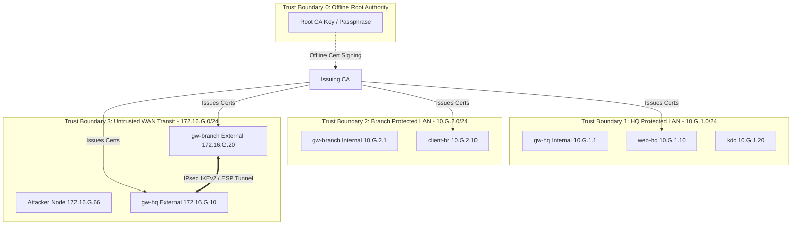

# Milestone 1: Network Topology & Trust Boundaries
**Project:** Secure Inter-Campus Communication Network  
**Course:** Secure Communication Protocols (1305301) — Al al-Bayt University  

---

## 1. Physical & Logical Lab Architecture

The lab models two academic campuses connected across an untrusted carrier WAN. All IP addressing and hostnames are parameterized by the Group Number $G$ (formatted as 2 digits for DNS names, e.g., `g01`, and integer for IP subnets, e.g., `10.1.x.x`).

```
+---------------------------------------------------------------------------------------------------------+
|                                        OFFLINE ROOT CA REALM                                            |
|                          (Air-gapped / Non-networked cryptographic authority)                           |
|                                    CN=AABU SCP Root CA g${GROUP_ID}                                     |
+----------------------------------------------------+----------------------------------------------------+
                                                     | (One-time offline signing of Issuing CA)
                                                     v
+---------------------------------------------------------------------------------------------------------+
|                                         ONLINE PKI SERVICES                                             |
|                                   CN=AABU SCP Issuing CA g${GROUP_ID}                                   |
|                                 Distribution Point: http://pki.g${GROUP_ID}.scp.lab/crl/                |
+---------------------------------------------------------------------------------------------------------+

 [BRANCH CAMPUS: 10.G.2.0/24]                      [UNTRUSTED WAN: 172.16.G.0/24]                      [HQ CAMPUS: 10.G.1.0/24]
 
 +---------------------------+                 +------------------------------------+                 +---------------------------+
 |         client-br         |                 |              attacker              |                 |          web-hq           |
 |        10.G.2.10          |                 |            172.16.G.66             |                 |         10.G.1.10         |
 | Staff Client workstation  |                 | Man-in-the-Middle / Eavesdropping  |                 | HTTPS Portal / mTLS Staff |
 +-------------+-------------+                 +-----------------+------------------+                 +-------------+-------------+
               |                                                 |                                                  |
        (Branch LAN)                                             | (Observes WAN)                             (HQ LAN)
               |                                                 |                                                  |
 +-------------+-------------+                 +-----------------+------------------+                 +-------------+-------------+
 |         gw-branch         | <============== |==== IKEv2 / ESP IPsec Tunnel ======| ==============> |           gw-hq           |
 | LAN: 10.G.2.1             |                 |   Auth: Mutual X.509 Certificates  |                 | LAN: 10.G.1.1             |
 | WAN: 172.16.G.20          |                 |     PFS: ECDH Group Curve25519     |                 | WAN: 172.16.G.10          |
 +---------------------------+                 +------------------------------------+                 +-------------+-------------+
                                                                                                                    |
                                                                                                              (HQ LAN)
                                                                                                                    |
                                                                                                      +-------------+-------------+
                                                                                                      |            kdc            |
                                                                                                      |         10.G.1.20         |
                                                                                                      |  Kerberos-style KDC Core  |
                                                                                                      +---------------------------+
```

---

## 2. Lab Nodes, Subnets, and Roles

| Node Name | Network Interface(s) | Assigned IP Address(es) | Primary Role | Allowed Outbound |
|---|---|---|---|---|
| **gw-hq** | `eth0` (WAN)<br>`eth1` (HQ LAN) | `172.16.G.10`<br>`10.G.1.1` | HQ Security & VPN Gateway | UDP 500/4500 & ESP to `gw-branch`; Internal LAN forwarding. |
| **gw-branch** | `eth0` (WAN)<br>`eth1` (Branch LAN) | `172.16.G.20`<br>`10.G.2.1` | Branch Security & VPN Gateway | UDP 500/4500 & ESP to `gw-hq`; Internal LAN forwarding. |
| **web-hq** | `eth0` (HQ LAN) | `10.G.1.10` | Campus Web Portal & CRL Distribution Point; Kerberos application service | Responds to authorized HTTPS / HTTP CRL requests. |
| **kdc** | `eth0` (HQ LAN) | `10.G.1.20` | Key Distribution Center (AS & TGS services) | Responds to ticket requests on TCP 8800. |
| **client-br** | `eth0` (Branch LAN) | `10.G.2.10` | Authorized Branch Staff Client workstation | Initiates HTTPS / mTLS requests; initiates KDC authentication. |
| **attacker** | `eth0` (WAN) | `172.16.G.66` | Authorized simulation node on untrusted WAN | Simulates packet capture, DNS poisoning, replay, and MITM. |

---

## 3. Trust Boundaries Analysis

The architecture enforces **Four Explicit Trust Boundaries**:



### Boundary 1: The Offline Root CA Boundary
- **Trust Level:** Highest (Root of Trust).
- **Enforcement:** Never connected to any network interface. Keys are protected with AES-256 passphrase. Only used to issue the Issuing CA certificate and its initial CRL.
- **Rule:** Absolute air-gap; must never reside inside a running container or service volume.

### Boundary 2: Untrusted WAN Transit (External Boundary)
- **Trust Level:** Zero / Adversarial.
- **Enforcement:** All traffic traversing `172.16.G.0/24` is assumed to be intercepted, modified, or forged by the `attacker` (`172.16.G.66`).
- **Rule:** Cleartext protocols are forbidden after Milestone 1 baseline. Gateways drop any non-IPsec packet on their WAN interfaces (Fail-Closed).

### Boundary 3: Protected Campus LANs (Internal Boundary)
- **Trust Level:** Semi-Trusted (Corporate LAN).
- **Enforcement:** Isolated from WAN by gateways using stateful packet filtering.
- **Rule:** Even within the LAN, sensitive applications enforce Zero Trust and Defense-in-Depth via Application-layer TLS, mTLS, and Kerberos-style session tickets.

---

## 4. Entity Trust Rules Matrix

| Entity | Allowed Capabilities | Strictly Prohibited Actions |
|---|---|---|
| **Root CA** | Sign Issuing CA certificate and Root CRL only. | Sign any end-entity certificate; execute online inside service containers. |
| **Issuing CA** | Issue server, gateway, and staff certificates following approved profiles; revoke certificates and publish CRL. | Issue subordinate CA certificates (`pathlen:0`); issue certificates without SAN or with conflicting EKU. |
| **Campus Gateways** | Authenticate peer gateway with X.509 cert; negotiate IKEv2/IPsec; enforce fail-closed firewall. | Accept PSK authentication; accept end-user staff certificates as gateway peers; forward LAN packets in cleartext when VPN is down. |
| **Portal (`web-hq`)** | Serve HTTPS with HSTS; validate client certificates against CRL for `/staff/`. | Support TLS < 1.2; accept non-AEAD suites; allow access with revoked client certificate. |
| **Staff Client** | Access `/staff/` with issued personal certificate; request tickets from KDC. | Use unverified connections (`curl -k`); share private keys across members. |
| **KDC** | Verify principal credentials; issue time-bounded TGTs and Service Tickets. | Transmit long-term master keys across network; accept authenticators outside replay freshness window. |
| **Attacker** | Sniff WAN packets, simulate DNS redirect, replay messages, test downgrade inside isolated lab. | Conduct any attack outside lab subnets (`172.16.G.0/24`, `10.G.0.0/16`); install Rogue CA in host OS trust store. |
