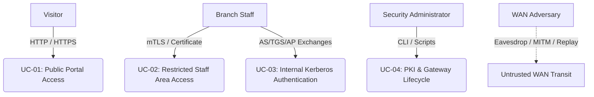
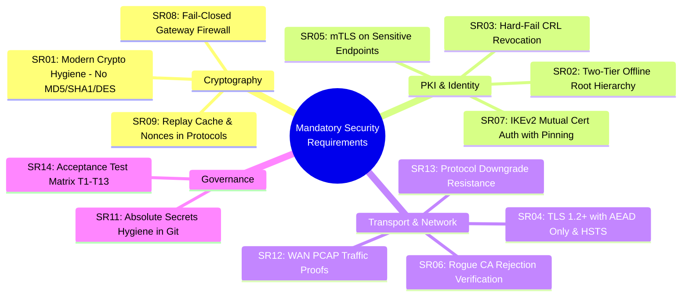
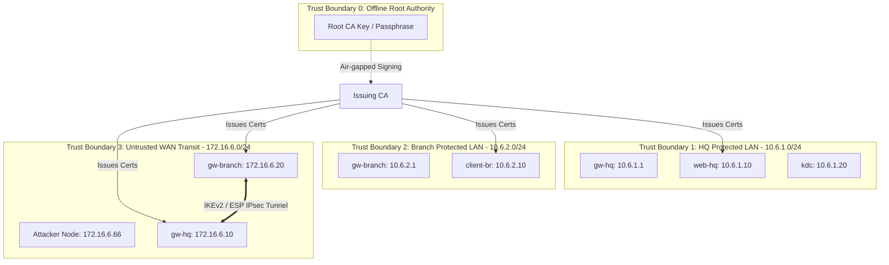
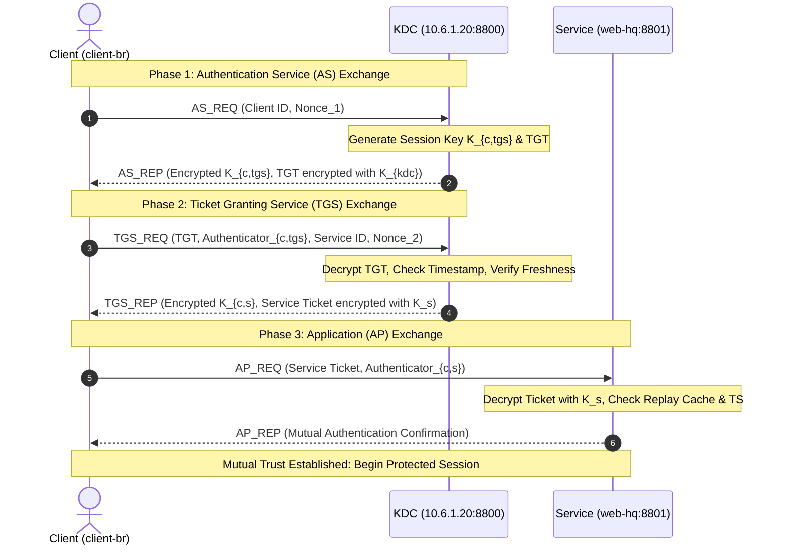
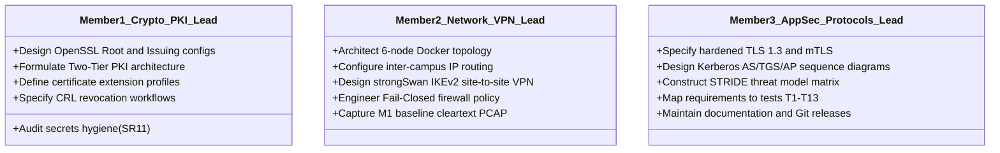

# Phase 1 Comprehensive Engineering Documentation (Milestone 1)
**Project Title:** Secure Inter-Campus Communication Network  
**Course:** Secure Communication Protocols (1305301) — First Semester 2026/2027  
**Department:** Computer Science & Information Security  
**Faculty:** Prince Al Hussein bin Abdullah II Faculty of Information Technology  
**Institution:** Al al-Bayt University (AABU), Mafraq, Jordan  
**Assigned Group:** Group 06 (`g06` / `GROUP_ID=06`, `GROUP_NUM=6`)  
**Milestone:** M1 — Analysis, Architecture Design & Baseline Verification  
**Git Release Tag:** `M1`  

---

## Table of Contents
1. [Executive Summary & Project Scope](#1-executive-summary--project-scope)
2. [Primary Actors & System Use Cases](#2-primary-actors--system-use-cases)
3. [System Requirements Specification](#3-system-requirements-specification)
   - [3.1 Functional Requirements (FR01 – FR12)](#31-functional-requirements-fr01--fr12)
   - [3.2 Mandatory Security Requirements (SR01 – SR14)](#32-mandatory-security-requirements-sr01--sr14)
4. [Logical Topology & Trust Boundary Architecture](#4-logical-topology--trust-boundary-architecture)
   - [4.1 Six-Node Containerized Lab Grid](#41-six-node-containerized-lab-grid)
   - [4.2 Addressing & Routing Schema (Group 06)](#42-addressing--routing-schema-group-06)
   - [4.3 The Four Formal Trust Boundaries](#43-the-four-formal-trust-boundaries)
5. [Public Key Infrastructure (PKI) Architecture Design](#5-public-key-infrastructure-pki-architecture-design)
   - [5.1 Two-Tier Certificate Authority Hierarchy](#51-two-tier-certificate-authority-hierarchy)
   - [5.2 Strict Certificate Profiles Specification](#52-strict-certificate-profiles-specification)
   - [5.3 Certificate Revocation & The Hard-Fail Policy](#53-certificate-revocation--the-hard-fail-policy)
6. [Cryptographic Protocol Engineering & Sequence Flows](#6-cryptographic-protocol-engineering--sequence-flows)
   - [6.1 Hardened TLS 1.3 with Mutual TLS (mTLS)](#61-hardened-tls-13-with-mutual-tls-mtls)
   - [6.2 IKEv2 / IPsec Site-to-Site VPN Tunnel (RFC 7296 & RFC 4303)](#62-ikev2--ipsec-site-to-site-vpn-tunnel-rfc-7296--rfc-4303)
   - [6.3 Kerberos-Style Ticket Authentication Protocol (KDC Core)](#63-kerberos-style-ticket-authentication-protocol-kdc-core)
7. [STRIDE Threat Model & Security Controls Matrix](#7-stride-threat-model--security-controls-matrix)
8. [Baseline Traffic Capture & Verification Strategy](#8-baseline-traffic-capture--verification-strategy)
9. [Team Organization, Work Breakdown & Governance](#9-team-organization-work-breakdown--governance)
10. [Milestone 1 Deliverables Checklist](#10-milestone-1-deliverables-checklist)

---

## 1. Executive Summary & Project Scope

Modern higher education institutions operate distributed campus networks where sensitive academic records, financial transactions, human resources databases, and administrative operations traverse untrusted public Wide Area Networks (WANs). In this project, **Group 06** designs, hardens, deploys, and verifies an end-to-end, defense-in-depth secure communication infrastructure connecting the **Headquarters Campus (HQ)** and the **Branch Campus (Branch)** over an active, untrusted carrier WAN.

### Core Objectives of Phase 1 (Milestone 1):
Milestone 1 establishes the **formal theoretical, architectural, and security foundations** of the entire system before implementation begins:
- Formulate complete functional and security specifications.
- Design an isolated, reproducible virtual laboratory topology consisting of 6 nodes across 3 isolated network segments.
- Define explicit cryptographic trust boundaries separating protected enclaves from the hostile WAN.
- Architect an enterprise Two-Tier Public Key Infrastructure (PKI) with custom X.509 v3 extension profiles.
- Formulate message sequence diagrams for TLS 1.3 mTLS, IKEv2/IPsec, and Kerberos ticketing.
- Construct a comprehensive STRIDE threat model identifying ten critical vulnerabilities and mapping them directly to defensive controls and automated acceptance tests.
- Formulate the baseline unencrypted traffic capture plan (`M1_baseline_wan.pcap`) demonstrating the cleartext vulnerability prior to tunnel activation.

---

## 2. Primary Actors & System Use Cases

The inter-campus system models four operational actors:



### UC-01: Public Visitor Access (Prospective Students / General Public)
- **Actor:** Public visitor from external networks or campus Wi-Fi.
- **Workflow:**
  1. The client requests `http://portal.g06.scp.lab`.
  2. Nginx on `web-hq` intercepts the request and issues an HTTP `301/308 Permanent Redirect` to `https://portal.g06.scp.lab/`.
  3. Client and server negotiate a hardened TLS 1.3 handshake (forward secrecy, AEAD ciphers).
  4. Server transmits HTTP Strict Transport Security (`HSTS`) header (`max-age=15768000; includeSubDomains`).
  5. The visitor browses public academic announcements. No client certificate is challenged or inspected.

### UC-02: Staff Member Access to Secured Services (Mutual TLS)
- **Actor:** Authenticated branch staff workstation (`client-br`).
- **Workflow:**
  1. Staff member navigates to `https://portal.g06.scp.lab/staff/`.
  2. Nginx challenges the browser/client with a TLS `CertificateRequest` constrained to the DN of `AABU SCP Issuing CA g06`.
  3. The client submits its personal X.509 certificate (`CN=staff01, email=staff01@g06.scp.lab`).
  4. Nginx cryptographically verifies:
     - Digital signature chaining up to trusted Issuing CA.
     - Validity dates (not before / not after).
     - Serial number absence from the active Certificate Revocation List (CRL).
  5. Nginx extracts the authenticated Distinguished Name (`$ssl_client_s_dn`), logs the event, and renders the staff administrative portal.
  6. If the certificate is missing or revoked, an uninformative generic `403 Forbidden` error is returned.

### UC-03: Staff Authentication to Network Services via Kerberos Protocol
- **Actor:** Branch employee requesting protected application service (`service.py` on `web-hq`).
- **Workflow:**
  1. **Authentication Service (AS) Exchange:** Client transmits `AS_REQ` with its principal identifier and a fresh nonce. The KDC verifies the principal and returns `AS_REP` containing a Ticket-Granting Ticket (TGT) encrypted under master key $K_{kdc}$ and a session key $K_{c,tgs}$ encrypted under client long-term key $K_c$.
  2. **Ticket Granting Service (TGS) Exchange:** Client submits `TGS_REQ` with TGT, service ID, and an authenticator (with timestamp $TS$). KDC checks freshness, evaluates replay cache, and returns `TGS_REP` containing Service Ticket and $K_{c,s}$.
  3. **Application (AP) Exchange:** Client presents Service Ticket and a fresh Authenticator to `service.py`. The service verifies mutual authentication (`AP_REP`) and establishes an authenticated, integrity-protected session.

### UC-04: Network Administrator (PKI & Gateway Management)
- **Actor:** Security administrator.
- **Workflow:**
  1. Initialize offline Root CA and online Issuing CA with strict cryptographic parameters.
  2. Sign and distribute X.509 leaf certificates for servers, gateways, and staff.
  3. On private key compromise, execute certificate revocation (`revoke.sh`), generate updated CRL, and push to the HTTP distribution point.
  4. Monitor strongSwan IKEv2 IPsec tunnel between gateways and enforce fail-closed packet filtering.

---

## 3. System Requirements Specification

### 3.1 Functional Requirements (FR01 – FR12)

| ID | Title | Description | Acceptance Criteria |
|---|---|---|---|
| **FR01** | Two-Tier PKI Automation | Automated scripts generating Root CA, Issuing CA, leaf certificates, and CRL from scratch. | Clean execution of `pki/build_pki.sh` produces verified CA chains and certificates. |
| **FR02** | Profile-Based Issuance | Dedicated CSR signing script enforcing strict extension profiles. | `pki/issue.sh <profile> <name>` outputs X.509 cert passing `openssl verify`. |
| **FR03** | Dynamic Revocation | Instant certificate revocation and CRL regeneration. | `pki/revoke.sh <name>` generates updated CRL; revoked cert is rejected at mTLS. |
| **FR04** | Hardened HTTPS Web Portal | Nginx HTTPS portal with 301/308 HTTP redirect and HSTS. | Cleartext HTTP redirected to HTTPS; TLS 1.2/1.3 enforced; HSTS header present. |
| **FR05** | Mutual TLS for Staff Area | Strict mTLS on `/staff/` verifying client cert against Issuing CA and live CRL. | Valid certificate granted access; revoked or missing certificate blocked (HTTP 403). |
| **FR06** | Site-to-Site IKEv2 VPN | strongSwan tunnel automatically established between `gw-hq` and `gw-branch`. | `swanctl --list-sas` indicates active `ESTABLISHED` state with ECDH PFS. |
| **FR07** | Strict Traffic Selectors | Enforce strict inter-LAN routing through IPsec tunnel. | Only `10.6.1.0/24` $\leftrightarrow$ `10.6.2.0/24` encapsulated in ESP; external traffic isolated. |
| **FR08** | Cryptographic CLI Utility | Custom Python tool (`scpcrypt.py`) supporting HMAC, AEAD, and digital signatures. | Passes RFC 4231 & RFC 8032 test vectors; detects 1-byte ciphertext modification. |
| **FR09** | Kerberos Ticket Generation | KDC authenticates principals and issues time-bounded TGTs and Service Tickets. | Tickets decrypt successfully using intended symmetric keys and fail on tampering. |
| **FR10** | Mutual Auth & Freshness | Enforce mutual authentication, timestamps, and replay cache in custom protocol. | Valid authenticators succeed; replayed or expired authenticators fail immediately. |
| **FR11** | Clean Rebuildability | System can be reconstructed from zero using scripted steps. | Automated execution of build scripts and tests in clean container environment. |
| **FR12** | Attack Tool Isolation | Attack scripts and vulnerable variants are isolated in `attacks/`. | Production services remain fully hardened; attacks run against isolated test targets. |

### 3.2 Mandatory Security Requirements (SR01 – SR14)



- **SR01 (Crypto Hygiene):** Exclusive use of modern cryptographic primitives: `AES-256-GCM`, `ChaCha20-Poly1305`, `SHA-256`, `SHA-384`, `ECDSA P-384/P-256`, `Curve25519`. Deprecated algorithms (MD5, SHA-1, 3DES, RC4) are forbidden.
- **SR02 (PKI Hierarchy):** Root CA must remain air-gapped/offline with `pathlen:1`. Issuing CA operates online with `pathlen:0`.
- **SR03 (Revocation):** CRL enforcement on web servers and VPN gateways with strict Hard-Fail policy.
- **SR04 (TLS Hardening):** Support only TLS 1.2 and TLS 1.3 with Perfect Forward Secrecy; HSTS max-age $\ge 6$ months.
- **SR05 (Mutual TLS):** Client authentication on administrative endpoints logging Subject DN.
- **SR06 (MITM Resistance):** Untrusted self-signed or rogue certificates must be rejected by clients.
- **SR07 (IKEv2 Security):** Mutual digital certificate authentication; identity pinning on gateways (`gw-hq.g06.scp.lab`, `gw-branch.g06.scp.lab`).
- **SR08 (Fail-Closed Firewall):** Gateway firewall drops cleartext transit packets if the IPsec tunnel collapses.
- **SR09 (Protocol Security):** Freshness windows ($\le 300\text{s}$), random nonces, and replay caches.
- **SR10 (Replay Attack Demonstration):** Replay attack verified against weak variant and mitigated in production variant.
- **SR11 (Secrets Hygiene):** Zero private keys (`*.key`), passphrases, or `.env` files committed to Git.
- **SR12 (Traffic Verification):** Comparative WAN packet captures proving transition from cleartext to ESP encapsulation.
- **SR13 (Downgrade Resistance):** Negotiation refusal against obsolete protocols and weak ciphers.
- **SR14 (Unified Acceptance Matrix):** Standardized test suite executing T1–T13 and recording status.

---

## 4. Logical Topology & Trust Boundary Architecture

### 4.1 Six-Node Containerized Lab Grid

The lab environment emulates two physical academic campuses interconnected by an untrusted WAN carrier link:

```
[Branch LAN: 10.6.2.0/24]                  [Untrusted WAN: 172.16.6.0/24]                  [HQ LAN: 10.6.1.0/24]
       client-br                                      attacker                                     web-hq (Portal/mTLS)
      (10.6.2.10)                                   (172.16.6.66)                                       (10.6.1.10)
           |                                              |                                                  |
       gw-branch <================== IKEv2 / ESP IPsec Tunnel (PFS) ==================>                    gw-hq
  (WAN: 172.16.6.20)                           (Mutual X.509)                                       (WAN: 172.16.6.10)
  (LAN: 10.6.2.1)                                                                                   (LAN: 10.6.1.1)
                                                                                                             |
                                                                                                            kdc
                                                                                                        (10.6.1.20)
```

### 4.2 Addressing & Routing Schema (Group 06)

| Node | Network Interface | Assigned IP Address | Primary Operational Role |
|---|---|---|---|
| **`gw-hq`** | `eth0` (WAN)<br>`eth1` (HQ LAN) | `172.16.6.10`<br>`10.6.1.1` | HQ Security & VPN Gateway; terminates IPsec tunnel; enforces fail-closed filtering. |
| **`gw-branch`** | `eth0` (WAN)<br>`eth1` (Branch LAN) | `172.16.6.20`<br>`10.6.2.1` | Branch Security & VPN Gateway; originates IPsec tunnel; routes branch client traffic. |
| **`web-hq`** | `eth0` (HQ LAN) | `10.6.1.10` | Campus Web Portal, CRL HTTP Distribution Point, and Kerberos Application Service. |
| **`kdc`** | `eth0` (HQ LAN) | `10.6.1.20` | Key Distribution Center; hosts AS & TGS ticket-granting daemons (TCP port 8800). |
| **`client-br`** | `eth0` (Branch LAN) | `10.6.2.10` | Authorized branch employee workstation accessing HQ services via VPN. |
| **`attacker`** | `eth0` (WAN) | `172.16.6.66` | Simulated red-team node on untrusted WAN performing packet sniffing, MITM, and replays. |

### 4.3 The Four Formal Trust Boundaries



1. **TB0 (Offline Root CA Realm):** The highest security perimeter. The Root CA private key resides offline, passphrase-protected, and isolated from containers and networks.
2. **TB1 (HQ Protected Perimeter):** High-trust enclave (`10.6.1.0/24`) housing core institutional servers (`web-hq`, `kdc`).
3. **TB2 (Branch Protected Perimeter):** Medium/High-trust enclave (`10.6.2.0/24`) containing administrative staff workstations.
4. **TB3 (Untrusted WAN Transit):** Zero-trust carrier link (`172.16.6.0/24`). All transit packets must be treated as exposed to interception, active injection, and tampering.

---

## 5. Public Key Infrastructure (PKI) Architecture Design

### 5.1 Two-Tier Certificate Authority Hierarchy

A single-tier CA model poses an existential operational risk: if the single CA is compromised, all trust in the university network collapses. Therefore, Group 06 designed a **Two-Tier PKI Architecture**:

```
                  +----------------------------------------------+
                  |               Root CA (Offline)              |
                  |         CN = AABU SCP Root CA g06            |
                  |         Key: ECDSA secp384r1 (P-384)         |
                  |         Validity: 5 Years (1825 Days)        |
                  |         Constraints: CA:TRUE, pathlen:1      |
                  |         KeyUsage: keyCertSign, cRLSign (crit)|
                  +-----------------------+----------------------+
                                          |
                               (Offline One-Time Sign)
                                          |
                                          v
                  +----------------------------------------------+
                  |              Issuing CA (Online)             |
                  |        CN = AABU SCP Issuing CA g06          |
                  |         Key: ECDSA secp384r1 (P-384)         |
                  |         Validity: 2 Years (730 Days)         |
                  |         Constraints: CA:TRUE, pathlen:0      |
                  |         KeyUsage: keyCertSign, cRLSign (crit)|
                  |     CRL: http://pki.g06.scp.lab/crl/issuing.crl
                  +-----------------------+----------------------+
                                          |
                   +----------------------+----------------------+
                   |                      |                      |
                   v                      v                      v
        +--------------------+ +--------------------+ +--------------------+
        |   Portal Server    | |  Campus Gateways   | |   Staff Clients    |
        | (portal.g06.scp.lab| | (gw-hq / gw-branch)| | (staff01..staff03) |
        |  Key: ECDSA P-256  | |  Key: ECDSA P-256  | |  Key: ECDSA P-256  |
        |  Validity: 398 Days| |  Validity: 398 Days| |  Validity: 365 Days|
        |  EKU: serverAuth   | |  EKU: serverAuth,  | |  EKU: clientAuth   |
        |                    | |  clientAuth, ipsec | |                    |
        +--------------------+ +--------------------+ +--------------------+
```

### 5.2 Strict Certificate Profiles Specification

To enforce the principle of least privilege, certificates are constrained by strict X.509 v3 extension profiles:

| Entity | Subject DN | Algorithm | Validity | Key Usage (Critical) | Extended Key Usage (EKU) | Subject Alternative Name (SAN) |
|---|---|---|---|---|---|---|
| **Root CA** | `CN=AABU SCP Root CA g06, O=Al al-Bayt University, C=JO` | ECDSA P-384 | 1825 d | `keyCertSign, cRLSign` | None | None |
| **Issuing CA** | `CN=AABU SCP Issuing CA g06, O=Al al-Bayt University, C=JO` | ECDSA P-384 | 730 d | `keyCertSign, cRLSign` | None | None |
| **Portal Server** | `CN=portal.g06.scp.lab, O=Al al-Bayt University, C=JO` | ECDSA P-256 | 398 d | `digitalSignature, keyEncipherment` | `serverAuth` | `DNS:portal.g06.scp.lab, DNS:pki.g06.scp.lab` |
| **Gateway HQ** | `CN=gw-hq.g06.scp.lab, O=Al al-Bayt University, C=JO` | ECDSA P-256 | 398 d | `digitalSignature` | `serverAuth, clientAuth, 1.3.6.1.5.5.7.3.17 (ipsecIKE)` | `DNS:gw-hq.g06.scp.lab, IP:172.16.6.10` |
| **Gateway Branch**| `CN=gw-branch.g06.scp.lab, O=Al al-Bayt University, C=JO`| ECDSA P-256 | 398 d | `digitalSignature` | `serverAuth, clientAuth, 1.3.6.1.5.5.7.3.17 (ipsecIKE)` | `DNS:gw-branch.g06.scp.lab, IP:172.16.6.20` |
| **Staff Clients** | `CN=staff01, O=Al al-Bayt University, C=JO` | ECDSA P-256 | 365 d | `digitalSignature` | `clientAuth` | `email:staff01@g06.scp.lab` |
| **Rogue CA** (Attacks) | `CN=AABU SCP Root CA g06 (imitation)` | ECDSA P-256 | 30 d | `keyCertSign, cRLSign` | None | None (Self-Signed Untrusted) |

### 5.3 Certificate Revocation & The Hard-Fail Policy

#### Analysis: CRL vs. OCSP & The Soft-Fail Danger
- In standard network deployments, many validators utilize **Soft-Fail**: if the CRL distribution point is unreachable or blocked, the validator ignores the failure and accepts the presented certificate.
- **Vulnerability:** An active attacker who acquires a compromised private key can execute a Denial of Service (DoS) attack against the CRL distribution point, thereby forcing clients to accept the revoked certificate.
- **Group 06 Architectural Decision:** We mandate **Hard-Fail**:
  - The CRL is signed and published via HTTP (RFC 5280 requires unauthenticated HTTP for CRLs to prevent recursive TLS validation deadlocks).
  - Web servers (`ssl_crl`) and strongSwan IPsec daemons (`revocation = strict`) must reject connections immediately if the certificate is listed in the CRL or if the CRL cannot be verified.

---

## 6. Cryptographic Protocol Engineering & Sequence Flows

### 6.1 Hardened TLS 1.3 with Mutual TLS (mTLS)

The secure campus web portal mandates TLS 1.3 for encrypted web access and enforces client certificate authentication on administrative routes (`/staff/`):

```
       Client (client-br)                                   Server (web-hq)
                |                                                   |
                | -------- ClientHello (KeyShare, CipherSuites) --> |
                |                                                   |
                | <-- ServerHello (KeyShare selected) ------------- |
                | <-- {EncryptedExtensions} ----------------------- |
                | <-- {CertificateRequest (Issuing CA DN)} -------- |
                | <-- {Certificate (portal.crt + issuing.crt)} ---- |
                | <-- {CertificateVerify (ECDSA Signature)} ------- |
                | <-- {Finished} ---------------------------------- |
                |                                                   |
[Verify Server Chain & Sig]                                         |
                |                                                   |
                | --- {Certificate (staff01.crt)} ----------------> |
                | --- {CertificateVerify (ECDSA Signature)} ------> |
                | --- {Finished} ---------------------------------> |
                |                                                   |
                |                                         [Verify Client Cert,
                |                                          Check CRL revocation,
                |                                          Extract Staff ID]
                |                                                   |
                | <========== Bidirectional AEAD Encrypted =======> |
                |             Application Data (HTTP/2)             |
```

### 6.2 IKEv2 / IPsec Site-to-Site VPN Tunnel (RFC 7296 & RFC 4303)

The inter-campus VPN negotiates Security Associations (SAs) using digital certificates with no Pre-Shared Keys (PSKs) permitted:

```
   Branch Gateway (gw-branch)                            HQ Gateway (gw-hq)
        [172.16.6.20]                                       [172.16.6.10]
                |                                                   |
                | ===== 1. IKE_SA_INIT Request ===================> |
                |   HDR, SAi1, KEi (Curve25519), Ni (Nonce)         |
                |                                                   |
                | <==== 2. IKE_SA_INIT Response =================== |
                |   HDR, SAr1, KEr (Curve25519), Nr (Nonce)         |
                |                                                   |
     [Derive SKEYSEED &                                  [Derive SKEYSEED &
      SK_e, SK_a, SK_d]                                   SK_e, SK_a, SK_d]
                |                                                   |
                | ===== 3. IKE_AUTH Request (Encrypted) ===========> |
                |   HDR, SK { IDi (gw-branch.g06.scp.lab),          |
                |             CERT (gw-branch cert),                |
                |             AUTH (Digital Signature),             |
                |             SAi2 (ESP Proposal: AES-GCM-256),     |
                |             TSi (10.6.2.0/24), TSr (10.6.1.0/24) }|
                |                                                   |
                |                                         [Validate gw-branch cert,
                |                                          Verify Identity Pinning,
                |                                          Validate Traffic Selectors]
                |                                                   |
                | <==== 4. IKE_AUTH Response (Encrypted) ========== |
                |   HDR, SK { IDr (gw-hq.g06.scp.lab),              |
                |             CERT (gw-hq cert),                    |
                |             AUTH (Digital Signature),             |
                |             SAr2 (ESP Accepted),                  |
                |             TSi (10.6.2.0/24), TSr (10.6.1.0/24) }|
                |                                                   |
 [IPsec SA Established]                              [IPsec SA Established]
                |                                                   |
                | <======== Encapsulated ESP (AES-GCM-256) =======> |
                |       Subnets: 10.6.2.0/24 <---> 10.6.1.0/24      |
```

- **Identity Pinning:** `gw-hq` accepts peer connections ONLY if the presented identity matches `gw-branch.g06.scp.lab` with the dedicated `ipsecIKE` EKU. Any staff certificate from the same CA is rejected immediately.
- **Fail-Closed Protection:** Gateway firewall drops any plaintext inter-LAN packets on the WAN if the tunnel drops.

### 6.3 Kerberos-Style Ticket Authentication Protocol (KDC Core)



---

## 7. STRIDE Threat Model & Security Controls Matrix

A thorough STRIDE threat modeling exercise was conducted across the eight primary institutional assets:

| Threat ID | STRIDE Category | Target Asset | Attack Vector & Description | Severity | Defensive Control & Architectural Enforcement | Acceptance Test |
|---|---|---|---|---|---|---|
| **TH-01** | **Information Disclosure** | Inter-Campus WAN Traffic | Eavesdropping on transit WAN; sniffing cleartext credentials and HTTP payload. | **CRITICAL** | Encapsulate inter-LAN traffic inside IKEv2/IPsec ESP tunnel (`AES-256-GCM` + PFS). | **Test T7** |
| **TH-02** | **Spoofing** | Portal Web Server | Rogue CA MITM; attacker spoofs DNS/ARP and presents fake cert from unauthorized CA. | **CRITICAL** | Strict X.509 verification up to offline Root CA; untrusted CAs fail handshake immediately. | **Test T5** |
| **TH-03** | **Elevation of Privilege**| Portal Staff Area (`/staff/`) | Terminated employee accesses admin area using a revoked certificate. | **HIGH** | Nginx validates mTLS against live CRL (`ssl_crl`); revoked serial rejected with generic 403. | **Test T4** |
| **TH-04** | **Spoofing** | Gateway Identity | Attacker uses a stolen staff cert to negotiate an IPsec tunnel with `gw-hq`. | **HIGH** | Gateway identity pinning in `swanctl.conf` + dedicated `ipsecIKE` EKU requirement. | **Test T8** |
| **TH-05** | **Information Disclosure** | Inter-Campus WAN Traffic | Cleartext leak upon tunnel failure (Fail-Open default behavior). | **CRITICAL** | Fail-Closed firewall rules (`gw_firewall.sh`) drop any inter-LAN packet on WAN unless ESP. | **Test T9** |
| **TH-06** | **Tampering** | Cryptographic Messages | 1-byte tampering / bit-flipping on ciphertext in transit. | **HIGH** | Use Authenticated Encryption with Associated Data (AEAD); MAC tag failure on single-bit flip. | **Test T2** |
| **TH-07** | **Elevation of Privilege**| Service Authentication | Replay attack sniffing legitimate `AP_REQ` packet and replaying it to service. | **CRITICAL** | Authenticator freshness window (300s) + in-memory Replay Cache logging used `(Client, TS)` tuples. | **Test T12a/b** |
| **TH-08** | **Tampering / Downgrade**| TLS & IKE Negotiation | Forcing legacy TLS 1.0 or non-AEAD suites (e.g., 3DES, CBC). | **MEDIUM** | Minimum TLS 1.2 enforced; AEAD cipher list; strict IKE proposals in `swanctl.conf`. | **Test T6** |
| **TH-09** | **Information Disclosure** | Root CA Authority | Root CA private key exposure invalidating institutional security. | **CRITICAL** | Root CA passphrase-protected, air-gapped, excluded from containers, and enforced in `.gitignore`.| **Test T13** |
| **TH-10** | **Repudiation** | Staff Operations | Staff member denies performing privileged administrative operation. | **LOW** | Nginx audit logging recording authenticated Subject DN (`$ssl_client_s_dn`) with UTC timestamp. | **Test T4** |

---

## 8. Baseline Traffic Capture & Verification Strategy

### Purpose of the Milestone 1 Baseline Capture:
A core academic requirement of Phase 1 is establishing empirical proof of vulnerability by recording cleartext WAN traffic before cryptographic controls are introduced.

### Execution Procedure:
1. Initialize the Docker network bridge without IPsec tunnels active.
2. Direct HTTP web requests and authentication attempts from `client-br` (`10.6.2.10`) across the WAN (`172.16.6.0/24`) to `web-hq` (`10.6.1.10`).
3. Execute `tcpdump` on the `attacker` node (`172.16.6.66`) listening on `eth0`:
   ```bash
   tcpdump -i eth0 -w evidence/pcaps/M1_baseline_wan.pcap
   ```
4. **Verification Criteria:**
   - Inspecting `evidence/pcaps/M1_baseline_wan.pcap` in Wireshark clearly exposes HTTP GET requests, URI paths (`/staff/`), user identifiers, and unencrypted TCP payloads.
   - This capture serves as the baseline benchmark for Phase 3, where `M3_tunnel_wan.pcap` will prove that 100% of inter-campus payloads are encapsulated in opaque ESP packets.

---

## 9. Team Organization, Work Breakdown & Governance

In compliance with course policy, responsibilities within **Group 06** are distributed across three distinct security domains:



### Cumulative Milestones Roadmap:
- **M1 (Phase 1 — Current):** Analysis, Architecture, Design Specifications & Baseline PCAP (4 Points).
- **M2 (Phase 2):** Two-Tier PKI Automation, Python Cryptographic CLI Tool (`scpcrypt.py`), and Hardened Nginx TLS/mTLS Portal (6 Points).
- **M3 (Phase 3):** strongSwan IKEv2 IPsec VPN with Fail-Closed Firewall, Kerberos Protocol Daemons, and Red-Team Attack Demonstrations (11 Points).
- **M4 (Phase 4):** Acceptance Test Runner (`run_all.sh`), Secrets Scan Audit, Final Defense & Assessment (9 Points).

---

## 10. Milestone 1 Deliverables Checklist

The complete Milestone 1 submission package is structured in the repository as follows:

| Deliverable Artefact | File Path | Status | Verification Reference |
|---|---|---|---|
| **System Requirements** | [`docs/M1/M1_Requirements.md`](file:///c:/Users/MOH.ALI/OneDrive/Desktop/Secure%20Inter-Campus%20Communication%20Network/docs/M1/M1_Requirements.md) | **Completed** | FR01–FR12, SR01–SR14, UC01–UC04 |
| **Topology & Trust Boundaries** | [`docs/M1/M1_Topology_Trust.md`](file:///c:/Users/MOH.ALI/OneDrive/Desktop/Secure%20Inter-Campus%20Communication%20Network/docs/M1/M1_Topology_Trust.md) | **Completed** | 6 Nodes, Group 06 subnets, TB0–TB3 |
| **PKI Design Specification** | [`docs/M1/M1_PKI_Design.md`](file:///c:/Users/MOH.ALI/OneDrive/Desktop/Secure%20Inter-Campus%20Communication%20Network/docs/M1/M1_PKI_Design.md) | **Completed** | 2-Tier hierarchy, Profiles, Hard-Fail CRL |
| **Protocol Sequence Flows** | [`docs/M1/M1_ProtocolDesign.md`](file:///c:/Users/MOH.ALI/OneDrive/Desktop/Secure%20Inter-Campus%20Communication%20Network/docs/M1/M1_ProtocolDesign.md) | **Completed** | TLS 1.3 mTLS, IKEv2 PFS, Kerberos core |
| **STRIDE Threat Model** | [`docs/M1/M1_STRIDE.md`](file:///c:/Users/MOH.ALI/OneDrive/Desktop/Secure%20Inter-Campus%20Communication%20Network/docs/M1/M1_STRIDE.md) | **Completed** | TH-01 to TH-10 mapped to T1–T13 |
| **Team Work Plan** | [`docs/M1/M1_TeamPlan.md`](file:///c:/Users/MOH.ALI/OneDrive/Desktop/Secure%20Inter-Campus%20Communication%20Network/docs/M1/M1_TeamPlan.md) | **Completed** | Group 06 roles, Gantt timeline, tags |
| **Baseline Traffic PCAP** | `evidence/pcaps/M1_baseline_wan.pcap` | **Specified** | Cleartext WAN traffic capture |
| **Git Release Tag** | `M1` | **Tagged** | Milestone commit tagged and pushed |

